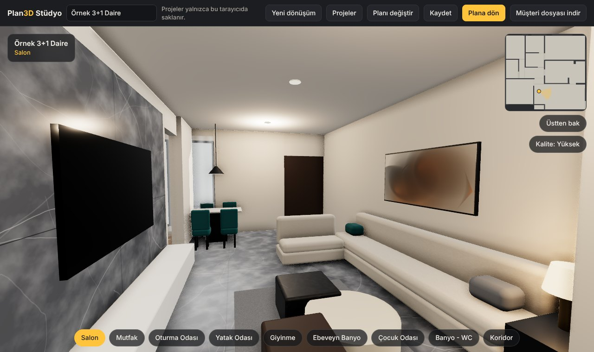
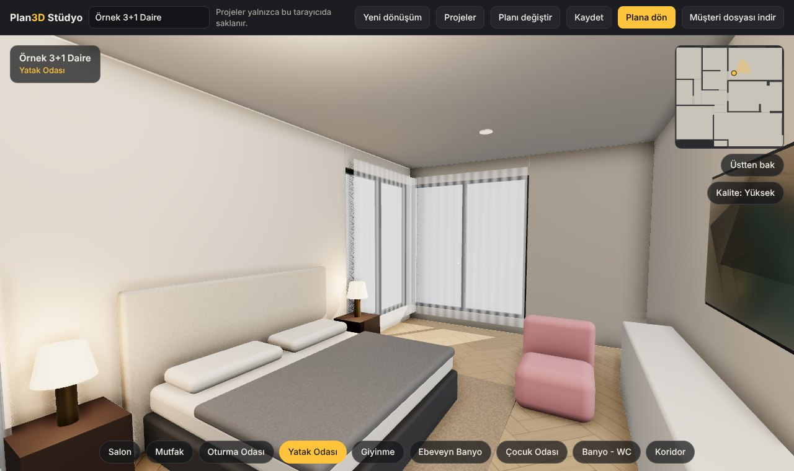
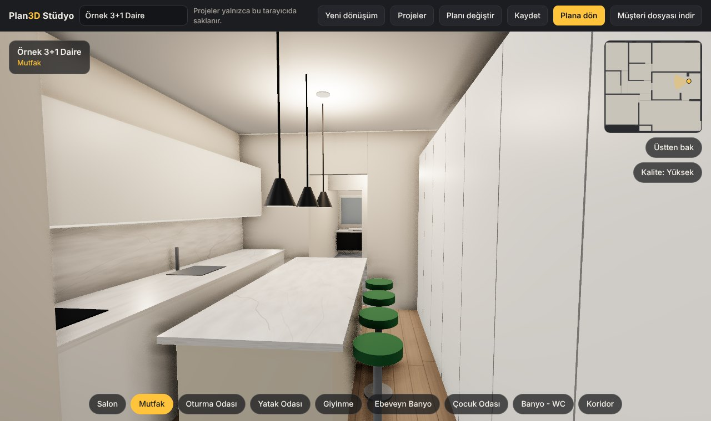
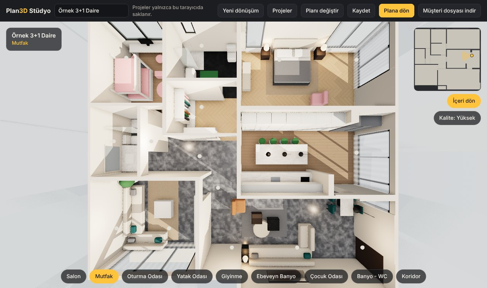
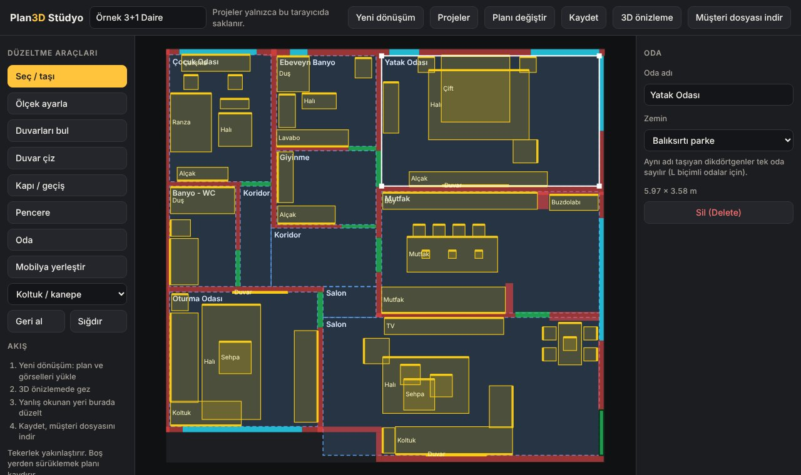
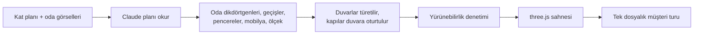

# Plan3D Stüdyo

**2D kat planını tarayıcıda gezilebilen 3D tura çevirir.** Planı ve oda görsellerini yüklersiniz; odalar, duvarlar, kapılar, pencereler ve mobilyalar kendiliğinden kurulur. Çıkan turu müşteriniz telefondan ya da bilgisayardan, hiçbir şey kurmadan gezer.



Mimarlar, iç mimarlar, müteahhitler ve çizimden satış yapan herkes için: müşteriye render göstermek yerine evin içinde dolaştırın.

## Ne yapar

| | |
|---|---|
| **Plandan 3D'ye** | Kat planı görseli yüklenir, Claude planı okur, sayfa temiz ve yürünebilir bir 3D model kurar. |
| **Gezilebilir tur** | Fare ya da parmakla bakılır, klavye ya da ekran çubuğuyla yürünür. Zemine ya da mini plana dokununca oraya gidilir. |
| **Tek dosyalık teslim** | "Müşteri dosyası indir" kendi başına çalışan tek bir HTML üretir; herhangi bir sunucuya koyup linkini paylaşırsınız. |
| **Düzeltme ekranı** | Yanlış okunan duvar, kapı, oda ya da mobilya plan üstünde elle düzeltilir. |

## Ekran görüntüleri

| Yatak odası | Mutfak |
|---|---|
|  |  |

| Üstten bakış | Düzeltme ekranı |
|---|---|
|  |  |

Görüntüler depodaki örnek projeden (`demo/demo.json`) alınmıştır.

## Nasıl çalışır



1. **Okuma.** Plan görseli üstüne 0–1000 ölçekli bir cetvel ve ızgara çizilip Claude'a gönderilir. Claude odaları, aralarındaki geçişleri, pencereleri, giriş kapısını, mobilyaları ve planın gerçek genişliğini JSON olarak döndürür. Oda fotoğrafları yalnızca zemin, duvar rengi ve mobilya renklerini seçmek için kullanılır.
2. **Temizleme** (`src/auto.js`). Yaklaşık okuma kesin geometriye çevrilir: yakın oda kenarları ortak duvar çizgisine hizalanır, duvarlar odaların arasındaki boşluktan türetilir, kapılar iki odanın ortak duvarına oturtulur.
3. **Denetim.** Başlangıç odasından her odaya yürünebildiği kontrol edilir. Kopuk oda kalırsa kapı eklenir, kapı önünde kalan mobilya çıkarılır; yapılan her düzeltme kullanıcıya not olarak gösterilir.
4. **Sahne** (`src/engine.js`). Duvar, zemin, pencere ve mobilyalar koddan üretilir. İndirilmiş model ya da doku yoktur: mermer, parke ve kumaş dokuları tarayıcıda çizilir, 28 mobilya parçası parametrik kutulardan kurulur.

## Kurulum

```bash
npm install
npm run build
npm start        # http://localhost:8080
```

Node.js 18 ya da üstü gerekir.

### Nerede ne çalışır

Stüdyo bir [Claude](https://claude.ai) artifact'i olarak yayınlanmak üzere yazıldı. Bazı özellikler o ortamın sağladığı yeteneklere bağlıdır:

| Özellik | Claude artifact'i içinde | Yerelde (`npm start`) |
|---|---|---|
| Örnek proje, düzeltme ekranı, 3D önizleme | Çalışır | Çalışır |
| Plandan otomatik dönüştürme | Çalışır (kullanıcının Claude kullanımından harcar) | Çalışmaz |
| Proje kaydetme | Sayfanın veritabanında | Tarayıcının `localStorage` alanında |
| Müşteri dosyası indirme | Çalışır | Çalışmaz |

Yerelde otomatik dönüştürmeyi kullanmak için `src/studio.js` içindeki `runAuto` işlevini kendi görsel-dil modeli çağrınıza bağlamanız gerekir. İstem metni `buildPrompt`, yanıtı projeye çeviren işlev `buildFromAnalysis` olarak `src/auto.js` içinde ayrıdır.

## Proje yapısı

```
src/
  engine.js     3D motor: sahne kurulumu, dokular, mobilya kataloğu, yürüme ve çarpışma
  auto.js       Otomatik dönüşüm: Claude istemi ve okumayı projeye çeviren geometri
  studio.js     Stüdyo arayüzü: yükleme, düzeltme araçları, kaydetme, dışa aktarma
  viewer.js     Müşteri turunun giriş noktası
  index.html    Stüdyo sayfası
demo/demo.json  Örnek 3+1 daire projesi
scripts/        Derleme ve yerel sunucu
docs/           README görselleri
```

## Proje veri biçimi

Bir tur, tek bir JSON nesnesidir. Koordinatlar plan görselinin pikselidir; `pxPerMeter` gerçek ölçüye çevirir.

```json
{
  "name": "Örnek 3+1 Daire",
  "pxPerMeter": 66,
  "size": [794, 751],
  "walls": [[190, 2, 10, 324]],
  "doors": [{ "r": [136, 242, 54, 8], "head": 2.15 }],
  "windows": [{ "r": [24, 2, 140, 10], "sill": 0.9, "head": 2.4 }],
  "rooms": [{ "name": "Salon", "floor": "marble", "r": [284, 488, 500, 250] }],
  "furniture": [{ "t": "sofa", "r": [415, 686, 212, 50], "rot": 180, "c": "light" }]
}
```

`rot`, mobilyanın arkasının baktığı yöndür: 0 üst, 90 sağ, 180 alt, 270 sol.

## Sınırlar

- Görsel kalite temiz bir 3D model düzeyindedir; fotoğraf gerçekliği değildir. Işık gerçek zamanlı hesaplanır, önceden pişirilmiş değildir.
- Odalar dikdörtgen olarak okunur; L biçimli odalar iki üç dikdörtgenle kurulur. Eğik ve yuvarlak duvarlar desteklenmez.
- Tek kat. Merdiven ve çok katlı plan yoktur.
- Otomatik okumanın doğruluğu planın netliğine bağlıdır; karmaşık planlarda elle düzeltme gerekebilir.
- Kapılar açık boşluk olarak kurulur; kapı kanadı ve kasa çizilmez.
- Düzeltme ekranı fare ve klavye içindir.

## Yol haritası

- Turların kendi alan adında barındırılması
- Önceden hesaplanmış ışık ile daha gerçekçi görüntü
- Tur içinde malzeme ve yükseltme seçenekleri, fiyat gösterimi
- İnceleyen kişinin neye baktığını kaydeden iletişim formu

## English

Plan3D Studio turns a 2D floor plan image into a walkable 3D tour that runs in the browser. Upload a plan and optional room photos; Claude reads the rooms, openings, windows, furniture and scale, and the page derives clean walls, places doors on shared walls, verifies every room is reachable and builds a three.js scene. Everything is generated in code, with procedural textures and a parametric furniture catalogue. The result can be exported as a single self-contained HTML file.

The studio is written to run as a Claude artifact: automatic conversion, saved projects and file export rely on that runtime. The editor, the demo project and the 3D preview also run locally with `npm install && npm run build && npm start`.

## Teknoloji

[three.js](https://threejs.org) 0.187 · [esbuild](https://esbuild.github.io) · çerçevesiz JavaScript
